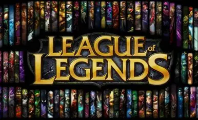
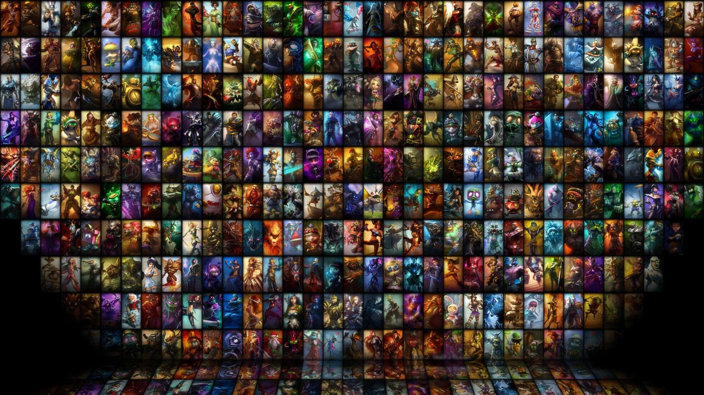
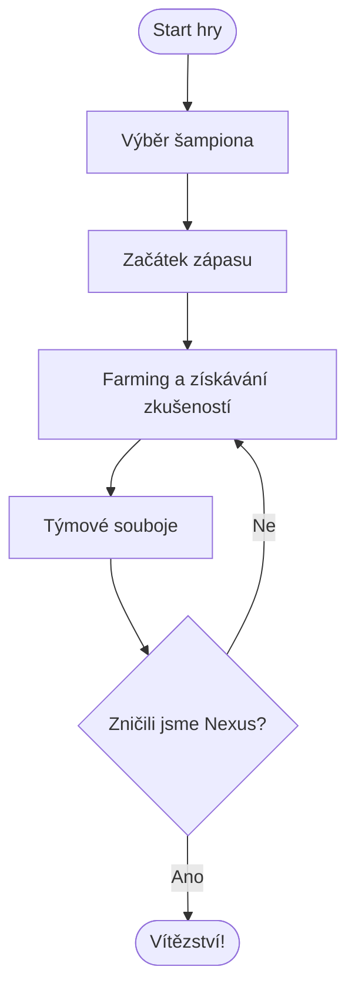

# League of Legends – Průvodce světem Runeterry

> „Prohra neznamená konec.“

Vítej ve světě **League of Legends**, populární týmové MOBA hry od společnosti Riot Games. V tomto průvodci se podíváme na herní režimy, role, šampiony a strategie, které ti pomohou ovládnout Summoner's Rift.



---

## 1. Co je League of Legends?

**League of Legends (LoL)** je strategická online hra, ve které proti sobě bojují dva týmy po pěti hráčích.

Hlavním cílem hry je zničit nepřátelský **Nexus**.

### 1.1 Základní informace

- Vývojář: Riot Games
- Žánr: MOBA
- Počet hráčů: 10 (5 proti 5)
- Herní mapa: Summoner's Rift
- Platforma: PC

### 1.2 Herní mapa

Na mapě Summoner's Rift najdeme tři hlavní linky:

1. **Top Lane** – horní linka.
2. **Mid Lane** – prostřední linka.
3. **Bot Lane** – spodní linka.

Mezi linkami se nachází **Jungle**, kde se pohybují neutrální příšery a jungler.

---

## 2. Herní role

Každý hráč má v týmu svou roli a úkol.

| Role | Pozice | Hlavní úkol |
|---|---|---|
| Top | Horní linka | Souboje a tlak na mapě |
| Jungle | Džungle | Ganky a objektivy |
| Mid | Prostřední linka | Poškození a roaming |
| ADC | Spodní linka | Způsobování poškození |
| Support | Spodní linka | Pomoc týmu a ochrana |

### 2.1 Moje oblíbené role

Mou oblíbenou rolí je **Mid Lane**, protože nabízí velký prostor pro individuální dovednosti a ovlivňování celé mapy.

---

## 3. Zajímaví šampioni

V League of Legends existuje velké množství šampionů s různými schopnostmi.



*Obrázek: Šampioni z League of Legends.*

| Šampion | Role | Obtížnost |
|---|---|---|
| Yasuo | Mid | Vysoká |
| Ahri | Mid | Střední |
| Jinx | ADC | Střední |
| Garen | Top | Nízká |
| Lee Sin | Jungle | Vysoká |

### 3.1 Doporučení pro začátečníky

- **Garen** – jednoduchý šampion na Top Lane.
- **Annie** – dobrá volba pro Mid Lane.
- **Ashe** – vhodná pro učení základů ADC.
- **Amumu** – užitečný jungler pro začátečníky.

---

## 4. Důležité herní objekty

Během hry je důležité získávat neutrální objekty.

- **Dragon** – poskytuje týmové bonusy.
- **Baron Nashor** – poskytuje silný bonus pro tým.
- **Void Grubs** – pomáhají při dobývání věží.
- **Rift Herald** – pomáhá s tlakem na věže.

**Tip:** Dobrá týmová spolupráce je často důležitější než počet získaných killů.

---

## 5. Digitální laboratoř – Počítání killů

Jednoduchý Python program, který spočítá KDA hráče.

```python
kills = 12
deaths = 3
assists = 8

if deaths == 0:
    kda = kills + assists
else:
    kda = (kills + assists) / deaths

print("Výsledky zápasu:")
print("Kills:", kills)
print("Deaths:", deaths)
print("Assists:", assists)
print("KDA:", round(kda, 2))
```

---

## 6. Můj LoL To-Do list

- [x] Naučit se základní ovládání hry.
- [x] Vyzkoušet několik šampionů.
- [ ] Zlepšit last hitting.
- [ ] Naučit se lépe pracovat s mapou.
- [ ] Zlepšit komunikaci s týmem.
- [ ] Dosáhnout vyšší rankové úrovně.
- [ ] Vyhrát 10 hodnocených zápasů za sebou.

---

## 7. Matematika League of Legends

KDA je jeden ze způsobů, jak vyjádřit statistiku hráče.

$$
KDA = \frac{Kills + Assists}{Deaths}
$$

Příklad:

$$
KDA = \frac{12 + 8}{3} = 6{,}67
$$

Čím vyšší KDA, tím lepší poměr eliminací a asistencí vůči smrtím. Samotné KDA ale neurčuje, jak dobře hráč skutečně hrál.

---

## 8. Diagram průběhu hry



---

## 9. Užitečné odkazy

- [Oficiální stránky League of Legends](https://www.leagueoflegends.com/)
- [League of Legends Wiki](https://wiki.leagueoflegends.com/)
- [OP.GG – statistiky hráčů](https://www.op.gg/)
- [U.GG – statistiky šampionů](https://u.gg/)

---

## 10. Závěr

League of Legends je hra, která vyžaduje strategii, rychlé rozhodování a týmovou spolupráci.

Nejdůležitější je:
1. Komunikovat s týmem.
2. Neustále se zlepšovat.
3. Zachovat klid i při prohraném zápase.
4. Hlavně si hru užívat!

---
